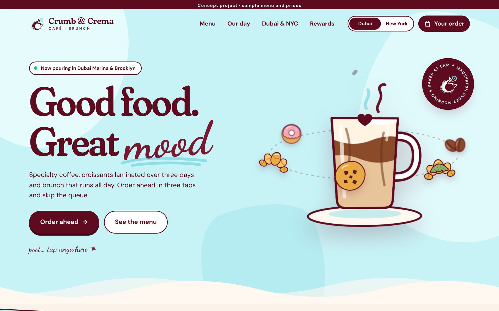
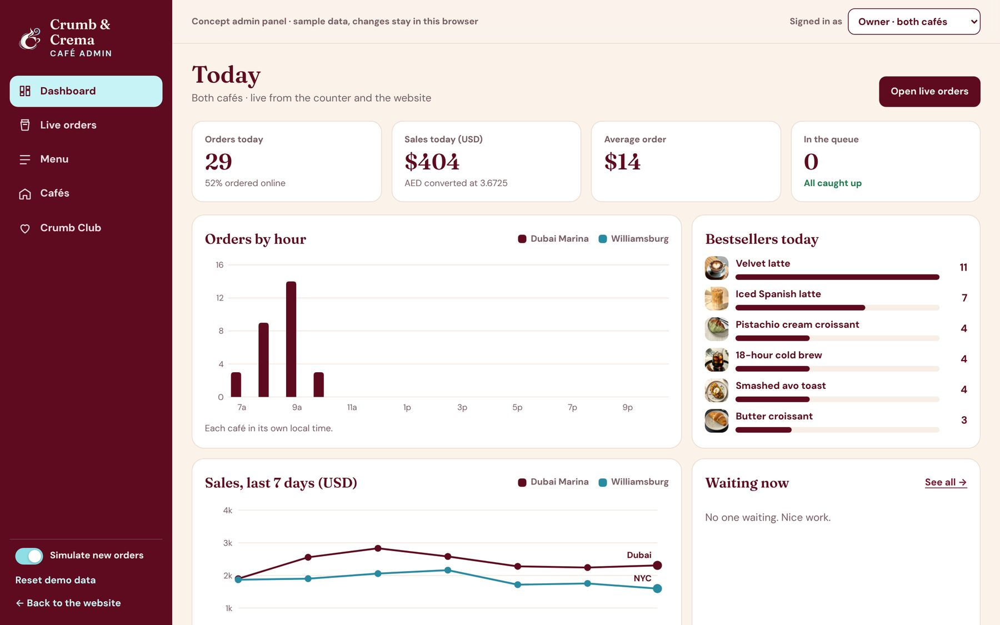

# Crumb & Crema

**Café brand, order-ahead website and admin panel** · designed and built by **Arooj Fatima**

A playful specialty café brand with branches in Dubai Marina and Brooklyn. I designed the logo and illustrations, then built an animated website where customers order ahead in three taps, priced in AED or USD by city, plus an admin panel for the menu, orders and both cafés.

## Tech
- React 19
- TypeScript
- esbuild
- CSS animation

## Notes
Self-initiated concept project with sample data, built to the standard of client work. No real bookings, orders or payments are made.

The full case study, with the design decisions behind it, is on my portfolio.

---

## Project details
Specialty café in Dubai Marina and Williamsburg, Brooklyn. Concept portfolio project by Arooj Fatima, with a sample menu, prices and addresses.

## What's in it
- **Home:** an animated hero (a latte that pours itself, pastries orbiting the glass in 3D, bouncy letters, and a burst of beans and hearts wherever you tap), crossing menu ribbons, bestsellers with tilt cards, a looping phone demo of ordering, a scroll-driven "day at the café" sky, live clocks for both cities and a stamp card that stamps itself.
- **Menu (#menu):** app-style ordering with a Dubai/New York switch (AED or USD), search, sticky categories, a product sheet with size, milk and extras, and fly-to-cart.
- **Checkout (#checkout)** with pickup slots worked out from the café's local time, then an **order tracker (#order)**.

## Admin panel (#admin)
Built into the same app so the demo works end to end: an order placed on the website shows up on the live board.
- **Dashboard:** orders, sales (USD equivalent for the owner, local currency for a barista), queue, orders by hour per café, 7-day sales, bestsellers.
- **Live orders:** New → Brewing → Ready → Collected board with drag and drop, late warnings, cancel with confirmation, simulated incoming orders.
- **Menu:** add new items (name, category, prices, photo, drink options), remove items, prices per city, badges, photo upload (cropped to a square JPEG), and a sold-out switch that greys the item out on the website.
- **Cafés:** pause online orders (checkout shows a message) and set pickup time (used on the menu and for pickup slots).
- **Crumb Club:** loyalty members with stamp cards.
- **Roles:** owner (both cafés) or barista (one café), which scopes every page.

## Stack
React 19 + TypeScript. Views in `src/views` map to Next.js `app/<route>/page.tsx`. Menu, branches and orders are designed to come from a Laravel API:
`GET /api/branches`, `GET /api/menu?branch=dxb`, `POST /api/orders`, `GET /api/orders/{id}`; admin: `PATCH /api/orders/{id}` (status), `PATCH /api/menu/{id}` (price, sold out, photo), `PATCH /api/branches/{id}` (pause, prep time), `GET /api/reports/today`, `GET /api/members`. Live board via Laravel Reverb or polling.

## Preview build
`node preview/build.mjs` writes `dist/index.html` (plus app.js and app.css) and a single-file `dist/crumb-and-crema.html`.
